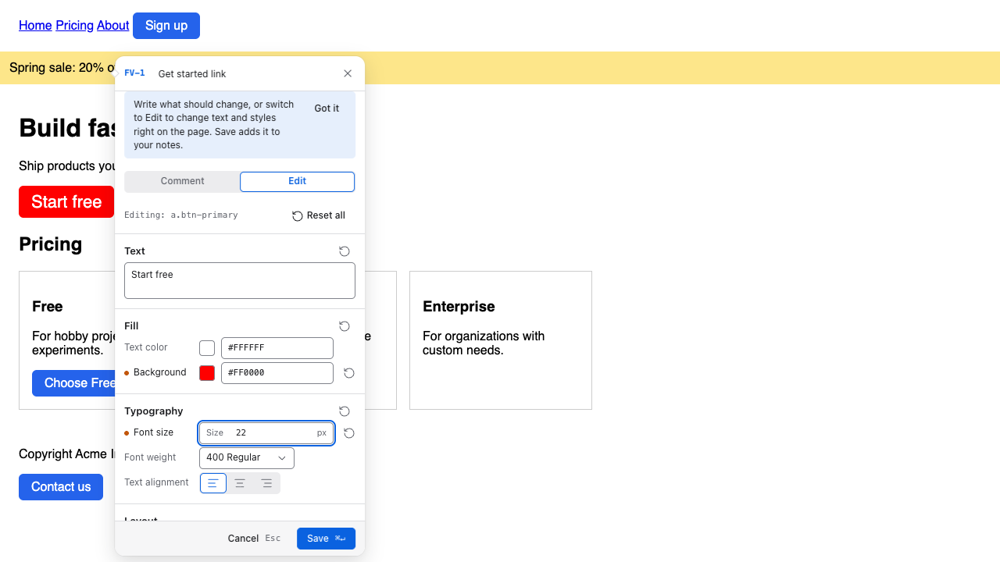
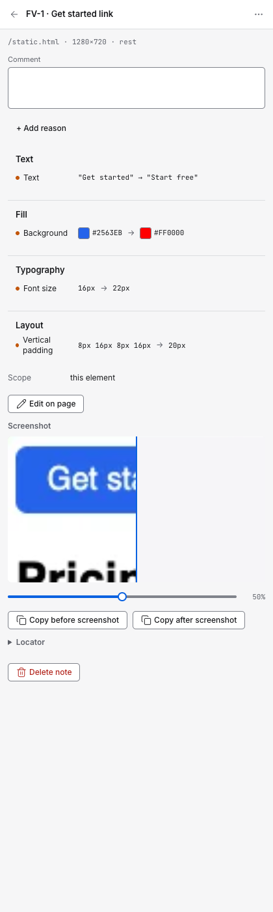

<p align="center">
  
</p>

<h1 align="center">Figval</h1>

<p align="center">
  Point at the live page, say what should change, hand over Markdown.<br>
  A Chrome extension for design review that a teammate or a coding agent can act on.
</p>

<p align="center">
  
  
</p>

---

Design feedback usually arrives as a screenshot with a red circle and "make this smaller". Someone then has to find the element, guess the value, and work out whether "this" means one button or every button.

Figval puts the feedback on the element itself. Click something on a real page, write a comment or change its text and styles in place, and Figval records exactly what you pointed at and what changed. When you're done, export the session as Markdown.

## What it does

- **Pick any element or text selection** on a regular website. Figval stores how to find it again: visible text, `data-testid` / `id` / `aria-label`, class names, DOM path and selector.
- **Comment or edit in place.** The Comment tab is for "what should change". The Edit tab changes text, color, size, spacing and radius live, so the note holds real before and after values.
- **Before / after screenshots** are captured for every note.
- **Scope and intent per note:** this element vs. all similar elements, and _apply_ vs. _propose_.
- **Two export formats:**
  - **LLM**: task nodes (`FV-1`, `FV-2`, …) with locate hints, computed values, an execution graph for overlapping changes, and instructions on when to skip or ask instead of guessing. Paste it into Claude Code, Cursor or any coding agent.
  - **Human**: a plain review document for whoever owns the page.
- **Local only.** Notes and screenshots live in your browser's storage. Figval has no server and uploads nothing.

<details>
<summary>Example LLM export</summary>

```markdown
# Figval Review — example.com

> Figval · session `fv-7k2q` · 2026-11-07 14:32 · 4 changes · 2 pages

## Execution graph

wave1[FV-1 ∥ FV-2 ∥ FV-3] → wave2[FV-4]
FV-4 depends on FV-1: both touch `a.btn-primary`; FV-4 overrides FV-1 for one instance.

## Page: `/` — Home · viewport 1440×900

### FV-1 · Hero CTA button

`text` `style` · scope: **all similar** (4 found) · intent: **apply** · state: rest

**Why:** Too loud, match the button style on /pricing

**Locate**

- Text: "Daftar Sekarang Juga!!"
- Attributes: `data-testid="hero-cta"`
  ...
```

</details>

## Install

**Chrome Web Store:** coming soon.

**From source:**

```bash
git clone https://github.com/afrianjunior/figval.git
cd figval
npm install
npm run build
```

Then open `chrome://extensions`, turn on **Developer mode**, choose **Load unpacked** and select `.output/chrome-mv3`.

## Using it

1. Open any website and click the Figval icon, or press <kbd>Alt</kbd>+<kbd>Shift</kbd>+<kbd>F</kbd>.
2. The first time on a site, Chrome asks whether Figval may access it.
3. Click an element (or select text), then comment or edit it.
4. Review your notes in the side panel, choose LLM or Human, then copy or download the Markdown.

Figval can't run on Chrome's own pages (`chrome://`, the Web Store). Your notes and export still work there.

## Permissions

| Permission                    | Why                                                    |
| ----------------------------- | ------------------------------------------------------ |
| `activeTab`, `scripting`      | Inject the picker into the tab you clicked the icon on |
| `sidePanel`                   | Show your notes next to the page                       |
| `storage`, `unlimitedStorage` | Keep notes and screenshots locally                     |
| `downloads`                   | Save the Markdown export                               |
| `<all_urls>` (optional)       | Requested per site, only when you press Pick           |

## Development

Built with [WXT](https://wxt.dev), React 19, [Effect](https://effect.website) and TypeScript.

| Command             | What it does                                                      |
| ------------------- | ----------------------------------------------------------------- |
| `npm run build`     | Production build to `.output/chrome-mv3`                          |
| `npx wxt zip`       | Build and zip for the Chrome Web Store                            |
| `npm run typecheck` | Type-check                                                        |
| `npm run lint`      | ESLint, zero warnings allowed                                     |
| `npm test`          | Unit tests (Vitest)                                               |
| `npm run coverage`  | Unit tests with enforced coverage thresholds                      |
| `npm run e2e`       | Builds the test variant and runs Playwright with visual snapshots |

```
src/
├── background/   service worker: sessions, capture, routing
├── content/      picker, tooltip and in-page edit engine
├── sidepanel/    note list, detail, export
├── welcome/      first-run onboarding tab
├── markdown/     LLM and Human renderers (golden-tested)
├── locator/      how an element is found again
├── storage/      IndexedDB + chrome.storage
├── messaging/    typed messages between contexts
├── platform/     thin, testable wrappers over chrome.* APIs
└── copy/         every user-facing string
```

`npm run build:test` produces `.output/chrome-mv3-test`, which adds `<all_urls>` host access for Playwright. Don't load it for normal use.
